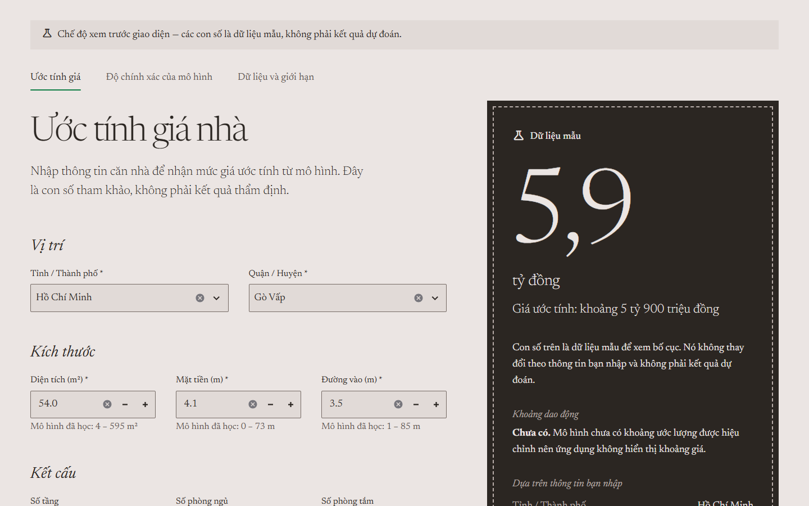
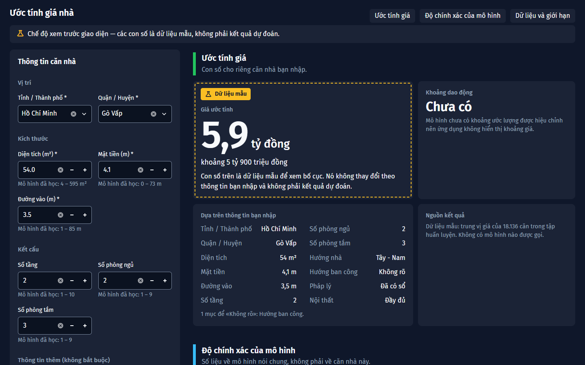
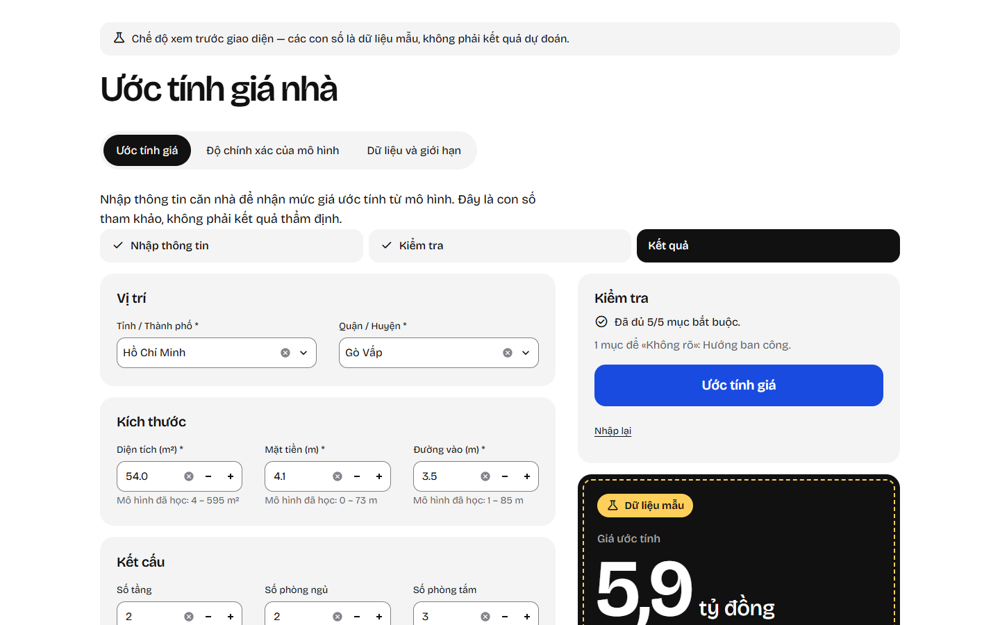
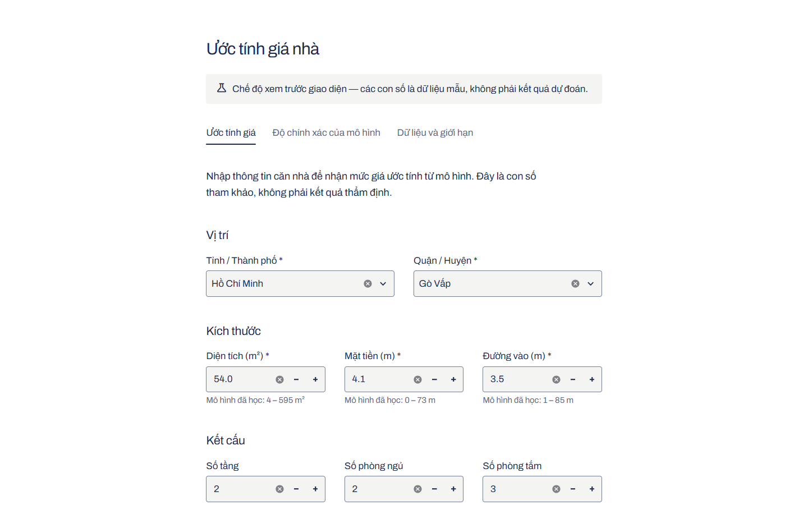

# Design lab — four prototypes of the house price estimator

Four runnable Streamlit prototypes of the same product, built from [`DESIGN_BRIEF.md`](DESIGN_BRIEF.md). They share one schema, one set of copy, one validation module and one model gateway, and differ only in theme, layout and markup.

**No prototype shows a real prediction.** The repository has no saved model, so every price on screen is a labelled sample. Nothing here is connected to the production app, which does not exist yet.

No winner is chosen in this document.

## Run

Streamlit was not installed anywhere on this machine, so the lab has its own environment at `design_lab/.venv` (Python 3.14, Streamlit 1.65.0, about 360 MB). Run each command from the repository root, in its own terminal:

```bash
design_lab/.venv/Scripts/python.exe -m streamlit run design_lab/concept_a.py --server.port 8601
```

```bash
design_lab/.venv/Scripts/python.exe -m streamlit run design_lab/concept_b.py --server.port 8602
```

```bash
design_lab/.venv/Scripts/python.exe -m streamlit run design_lab/concept_c.py --server.port 8603
```

```bash
design_lab/.venv/Scripts/python.exe -m streamlit run design_lab/concept_d.py --server.port 8604
```

To use another environment instead, install `design_lab/requirements.txt` (one line: `streamlit==1.65.0`) and run `streamlit run design_lab/concept_a.py`.

Things to know when running:

- The first time Streamlit runs on a machine it asks for an email address in the terminal. Press Enter to skip.
- Fonts load from Google Fonts, so the first load needs a network connection. Offline, each concept falls back to a system serif or sans and looks different.
- After editing anything in `design_lab/lab/`, restart the server. Streamlit did not reliably reload those modules during development.
- Each prototype opens in the sample-result state. The expander at the bottom of every page, "Công cụ phòng thiết kế", switches state. The same states are reachable by URL:

| URL | Shows |
|---|---|
| `?state=sample` | Sample result (default) |
| `?state=initial` | Empty form, no result |
| `?state=invalid` | Three blocking errors |
| `?state=unavailable` | The real situation today: no model, action disabled |
| `?state=error` | Simulated inference failure |
| `?view=do-chinh-xac`, `?view=du-lieu` | Opens the accuracy or data view (A, C, D; B shows everything on one page) |

## What is real and what is not

| On screen | Source | Real? |
|---|---|---|
| Model status ("Mô hình chưa sẵn sàng") | `models/` contains only a README | Real |
| City and district lists, numeric ranges | Training split, read at run time | Real, with a lab-only filter (see Findings) |
| Validation errors and range warnings | `lab/validation.py` on the actual input | Real |
| Cross-validation table and chart | `experiments/model_comparison_cv/recovered_model_cv_summary.csv` | Real, labelled as model selection, not final accuracy |
| Data facts, price histogram, missing rates | Training split, read at run time | Real |
| The price figure (5,9 tỷ đồng) | Median price of the training split | **Sample.** Labelled "Dữ liệu mẫu", fixed, ignores the input |
| The inference-error state | `SimulatedErrorGateway` | **Simulated**, and labelled so on screen |
| Uncertainty interval | — | Not shown anywhere. Always "Chưa có", because no calibrated interval exists |
| Final test metrics | — | Not shown anywhere. Always "Chưa có" |

## Shared structure

```
design_lab/
  concept_a.py … concept_d.py   entry points: theme, layout and markup only
  lab/
    schema.py       the 12 fields, groups, labels, the one sample property
    content.py      every Vietnamese string, shared word for word
    validation.py   blocking errors and out-of-range warnings
    gateway.py      the only seam to the model
    state.py        submit flow, lab states, result text
    reference.py    categories and ranges from the training split
    evaluation.py   reads the cross-validation files
    formatting.py   Vietnamese number formats
    ui.py           widgets with shared keys, charts, tables, lab controls
  check_prototypes.py   headless checks for all four
  screenshots/          captures at identical viewport sizes
```

The model seam is `lab/gateway.py`. All four prototypes call `ModelGateway.predict()` through `lab/state.py` and nowhere else. `ProjectModelGateway` is where the team's pipeline loader will go; today it only reports that no model exists. No model is loaded and the production pipeline is untouched.

## The four concepts

### A — Premium Real Estate



One light news serif for everything, a rose-grey page, and the price set at about 180px on an inverted plate beside the form. In the accuracy and data views, side facts sit beside a wide reading column.

- **Type:** Newsreader, weights 300–500.
- **Palette:** rose grey `#ebe5e3`, brown-black `#2b2622`, green `#0f7d45` on the action and the current tab only.

**Strengths**

- The result has the most presence of the four, and on desktop it stays beside the form while the form scrolls.
- One typeface and two tones give it the clearest identity.
- Body text contrast is 12:1.
- The accuracy view reads like a short report rather than a dashboard.

**Weaknesses**

- A confident, premium presentation sits uneasily with the current evidence (cross-validated average error near 1 tỷ đồng). The look promises more than the model has shown.
- Serif text inside form controls is unconventional for data entry, and weight 300 can look thin on low-resolution Windows screens.
- The action button is below the first screen on desktop, at the end of the form.
- The plate is tall. On a phone the page is about 4,200px long and the result comes after the whole form.
- It depends most on its web font; the fallback serif changes the character completely.

### B — Real Estate Analytics



One dark board. The form is a rail on the left; the canvas holds three labelled zones of tiles: the estimate for this house, the model's accuracy, and the data. Each zone has a coloured bar, a heading and a one-line statement of its scope.

- **Type:** Fira Sans with tabular figures.
- **Palette:** slate `#0F172A`, tiles `#1B2336` and `#243049`, green for the estimate zone, sky blue for the evaluation zone.

**Strengths**

- Estimate, model evidence and data are on one screen, so the evidence is the hardest to miss.
- Charts and metrics have the strongest hierarchy; the evaluation zone starts within the first screen at 1440×900.
- The separation of prediction from evaluation is explicit in three ways: position, bar colour and a written scope line.

**Weaknesses**

- It is the densest design and the least suited to the general public named in `PRODUCT.md`. MAE, RMSE and R² appear on the main screen next to the price.
- Despite the labels, the metric tiles describe a candidate pipeline in cross-validation. A reader can still take them for the accuracy of the figure above.
- Dark theme only. Tile labels and captions are 14.4px, below the 16px used elsewhere.
- The phone page is about 6,700px long. The rail leaves two fields alone on their rows.
- Two rows of identical tiles is the pattern the Taste inspector flags as generic.

### C — Modern Fintech



Input on the left in soft grey cards. On the right, a live check of the form, one large blue action, and a black stage for the figure. A three-part track shows where the person is between entering details and reading the result.

- **Type:** Bricolage Grotesque.
- **Palette:** white, grey `#f4f4f4`, black `#111111`, blue `#1a4be0` on the action only.

**Strengths**

- The clearest input-to-result path: track, live check, action, result, in reading order.
- The only concept where the action is visible in the first desktop screen, with the result directly under it.
- The figure on the black stage is highly legible (white on black, 18.9:1), and the amber sample label with its dashed frame is the hardest to overlook.
- Two-value fields are segmented controls, one tap each.

**Weaknesses**

- Validation appears in three places (live check card, error summary, inline messages). That may be reassuring or redundant; it needs testing.
- Track, cards and stage are three filled surfaces competing for attention.
- The typeface has a contemporary character that may read as fashionable rather than dependable.
- On desktop the left column ends well above the bottom of the stage, leaving empty space.
- On a phone the action sits after the whole form, and the navigation wraps to two rows.

### D — Minimalist



A single narrow column, one typeface at regular weight, navy on white and one tangerine button. No panels: the result is set as text under the action.

- **Type:** Archivo, regular, with semibold only on the button and short emphasis.
- **Palette:** white, navy `#1f2b4d`, tangerine `#f7941d` on the action only.

**Strengths**

- The least visual noise. The order is identical on phone and desktop.
- The smallest stylesheet and the closest to Streamlit's defaults, so the cheapest to maintain.
- Explanations read as plain paragraphs, which suits the estimate statement and the limits.
- Body text contrast is 13.9:1.

**Weaknesses**

- On desktop the result is below the form, more than a screen down, not beside it as the brief's wireframe intended.
- Nothing dominates the first screen; the largest type is 30px.
- It is the least distinctive and looks closest to an unstyled Streamlit app.
- The tangerine fill has only 2.3:1 contrast against white, so the button relies on its navy border and text.
- The sample-result treatment is the quietest of the four.

### Side by side

| | A Premium | B Analytics | C Fintech | D Minimalist |
|---|---|---|---|---|
| Layout | Form + sticky plate | Rail + tile board | Cards + check + stage | One column |
| Navigation | Text tabs | In-page links, one page | Segmented tabs | Text tabs |
| Result beside form on desktop | Yes | Yes | Yes | No |
| Action in first desktop screen | No | No | Yes | No |
| Evaluation visible with the estimate | No | Yes | No | No |
| Theme | Light | Dark | Light | Light |
| Phone page length | 4,162px | 6,679px | 3,892px | 3,816px |
| Two-value fields | Radios | Radios | Segmented | Radios |

## How the skills were used

**UI UX Pro Max.** One `--design-system` query per concept, plus focused searches from the brief. Each result was checked against the product and the Vietnamese requirement before use.

| Concept | Returned | Decision |
|---|---|---|
| A | Glassmorphism, hero landing pattern, Cinzel + Josefin Sans, teal | Not used. Cinzel has no Vietnamese glyphs in the skill's own font data; the pattern is for landing pages. |
| B | "Dark tech + status green" palette, Fira Code + Fira Sans | Palette and Fira Sans adopted. Border lightened from `#475569` to `#7C8BA1` to reach 3:1. Fira Code dropped. |
| C | Blue + orange palette, Poppins + Open Sans | Not used. Poppins has no Vietnamese glyphs. |
| D | Minimalism & Swiss Style, Inter | Style adopted as the basis; palette and font not used. |
| All | Form labels, error summary and inline errors, long-token wrapping, visible focus | Adopted in `lab/ui.py`. |

**Taste (`design-taste-frontend`).** Its own description excludes app screens, and its procedure requires photographs and a motion layer, so the procedure was not run. Three parts were used: the direction deal, the house rules, and the browser inspector.

| Concept | Direction dealt (seed) | Used | Changed |
|---|---|---|---|
| A | "The name as a monument" (223101500), chosen from three dealt | The idea, applied to the price; palette "Rose grey, green" | Type redrawn once (Bodoni Moda / Jost → Anton / Work Sans), then replaced by Newsreader from the skill's library: the first pair lacks Vietnamese glyphs, the second is a poster face. Muted text darkened to `#5e5551` for contrast. |
| B | "The well-kept board" (2126786358) | The tile-board composition | Type (Albert Sans, no Vietnamese glyphs) and palette replaced by the UI UX Pro Max result. |
| C | "The product performs" (1811807192) | The live-check idea; palette "Sheet and biro" | Type (Switzer, Vietnamese support unverified) replaced by Bricolage Grotesque from the skill's library. Muted text darkened to `#5f5f5f`. |
| D | "The quiet instrument" (191553536) | Archivo and palette "Navy on white", as dealt | Muted text darkened to `#5f667b`. |

The dealt sheets are kept in `.taste-skill/sheets/` (for A, the sheet after the type redraw).

The skill's linter found no files it can read (it does not scan `.py`). Its inspector ran against all four in a real browser, followed by one round of fixes:

| | A | B | C | D |
|---|---|---|---|---|
| Result | 3 FAIL, 5 WARN | 5 FAIL, 5 WARN | 3 FAIL, 4 WARN | 4 FAIL, 3 WARN |

- **Not applicable to a tool screen:** fewer than four photographs, no video, little motion. These are the skill's landing-page floors and were not pursued.
- **False positives:** Streamlit's icon font is read as monospace; the lab expander's border is read as a thin rule; in A the navigation tab is read as a label above the title.
- **Real and left as they are:** a label above the price in B, C and D; identical tile rows in B; no dominant element in D's first screen; the action outside the first screen in A, B and D.
- **Fixed after the first run:** the label above the price in A, A's type scale (the size-count warning cleared), B's line length, B's layout at tablet width.

No contrast failure was reported for any concept.

**Impeccable** was not invoked. `PRODUCT.md` was used as the source of product facts.

## Checks run

| Check | Result |
|---|---|
| `py_compile` on all four entry points and `lab/` | Pass |
| `check_prototypes.py`: each concept in all 5 states, then one interaction sequence | 4 of 4 pass |
| Browser load of each concept at 1440×900 and 390×844 | No Python exceptions, no console errors, no horizontal overflow |
| Web fonts | Each concept's font confirmed loaded in the browser |

The interaction sequence submits an empty form, changes the city, fills the required fields with one out-of-range value, submits, then edits a field. It asserts that validation fails first, the district is cleared, the warning is raised, the result is a labelled sample and the result is marked out of date after the edit.

Not checked: screen readers, keyboard-only use beyond focus styles, browsers other than Chrome, and real users.

## Screenshots

All captured with headless Chrome. The first column is the same 1440×900 viewport for every concept.

| Concept | 1440×900 | Full page | Model unavailable | Phone 390×844, full page |
|---|---|---|---|---|
| A | [view](screenshots/concept_a_desktop_1440x900.png) | [view](screenshots/concept_a_desktop_full.png) | [view](screenshots/concept_a_unavailable_1440x900.png) | [view](screenshots/concept_a_mobile_390x844_full.png) |
| B | [view](screenshots/concept_b_desktop_1440x900.png) | [view](screenshots/concept_b_desktop_full.png) | [view](screenshots/concept_b_unavailable_1440x900.png) | [view](screenshots/concept_b_mobile_390x844_full.png) |
| C | [view](screenshots/concept_c_desktop_1440x900.png) | [view](screenshots/concept_c_desktop_full.png) | [view](screenshots/concept_c_unavailable_1440x900.png) | [view](screenshots/concept_c_mobile_390x844_full.png) |
| D | [view](screenshots/concept_d_desktop_1440x900.png) | [view](screenshots/concept_d_desktop_full.png) | [view](screenshots/concept_d_unavailable_1440x900.png) | [view](screenshots/concept_d_mobile_390x844_full.png) |

## Where the prototypes depart from the brief

- **Palette and type.** None of the four uses the teal palette or the Lexend pairing recommended in section 6 of the brief. They are the four alternatives requested afterwards. The brief's rules (contrast, 16px inputs, no gradients, glass or shadows at rest, icon plus text on every state) apply to all four.
- **Preview mode is on by default.** The brief says a product must ship with it off (FR-28). Here it is the default because these are review artefacts and there is no model.
- **Required fields are provisional.** The five fields with no missing values in the training split are required. The model's input contract will decide (OD-2).
- **Units are provisional.** m² and m are assumed (OD-1).
- **"Không rõ" assumes the final pipeline accepts missing values** (OD-2).
- **Two concepts add copy.** B adds a scope line per zone; C adds the track labels and the live-check sentences. All other text is identical.
- **The running state is not shown.** The preview gateway answers instantly, so there is no wait to display.
- **Streamlit limits, as the brief predicted:** the page language is announced as English, focus cannot be moved to the error summary, and number inputs use a decimal point.
- **Theme technique.** Each file sets Streamlit's theme options at run time so that one command works without flags. A production app should use `.streamlit/config.toml`.

## Findings for the team

- **Location data is dirty.** After the pipeline's own normalisation, the training split still has 302 city/district pairs that include junk strings and duplicate spellings, for example "Hồ Chí Minh giá 2tỷ380", "TP. HCM", and "Quận Bình Tân" next to "Bình Tân". The lab offers only pairs with at least 10 training rows: 108 pairs in 28 cities, covering 97.3% of rows. This filter is a lab stand-in, and the model sees the dirty values too.
- **Proposed Vietnamese copy needs review**, including "Đã có sổ", "Hợp đồng mua bán", "Đầy đủ" and "Cơ bản".
- **Open decisions in the brief still stand**, most of all the model's input contract and its metadata file (OD-2, OD-3).
